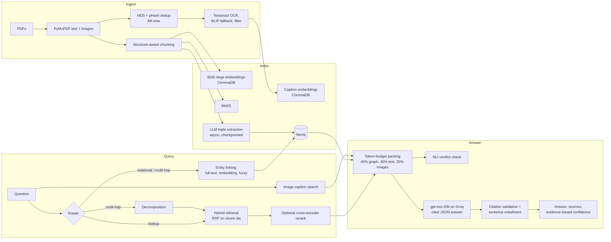
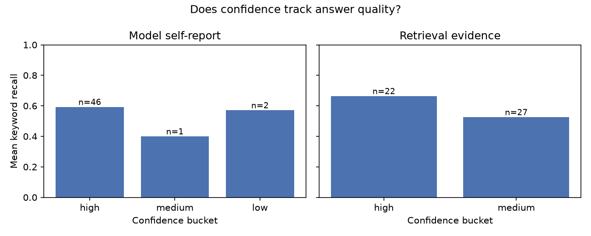

# graph-rag-multimodal

[](https://github.com/AyeshaMoghis/graph-rag-multimodal/actions/workflows/ci.yml)

A retrieval-augmented question-answering system over PDF lecture material that
combines three kinds of evidence: text chunks found by hybrid dense + BM25
search, image captions produced by OCR with a BLIP fallback, and a Neo4j
knowledge graph of concepts extracted by an LLM. Retrieved evidence is packed
into a token budget and answered by an LLM on Groq (`gpt-oss-20b`), and every answer sentence is
checked against the source it cites. The project started as a research notebook;
this repository is the production rewrite, including the fix for a fusion bug
that made the original "hybrid" retriever worse than dense search alone.

## Architecture



The FastAPI service exposes `/ask` (Server-Sent Events by stage), `/ingest`,
`/graph/subgraph` and `/health`; a Streamlit page in `demo/` renders the answer,
sources, images and the subgraph used.

## Results

### Retrieval ablation

Retrieval ablation on the original six-PDF lecture corpus (143 chunks) and its
50-question golden set: top 5 chunks, 3 runs per row, every cache off, CPU only.
Reproduce with `graphrag ablation`; raw numbers are in `results/ablation.json`.

<!-- ABLATION:START -->
| Config | Recall@5 | MRR | nDCG@5 | Context keyword recall | p50 latency |
|---|---|---|---|---|---|
| dense only | 0.773 | 0.934 | 0.775 | 0.723 | 242 ms ± 4 |
| BM25 only | 0.653 | 0.789 | 0.623 | 0.691 | 1 ms |
| hybrid (broken fusion, original) | 0.650 | 0.581 | 0.525 | 0.647 | 256 ms ± 3 |
| hybrid (RRF, fixed) | 0.787 | 0.930 | 0.779 | 0.732 | 259 ms ± 17 |
| hybrid + rerank | 0.787 | 0.863 | 0.754 | 0.728 | 9263 ms ± 379 |
| hybrid + rerank + graph | pending | | | | needs Neo4j (NEO4J_* not set) |
| full (+ images) | pending | | | | needs Neo4j (NEO4J_* not set); needs image captions (run `graphrag index` without --skip-images) |

*Retrieval labels are automatic suggestions not yet reviewed by a human; Recall@5, MRR and nDCG@5 are provisional.*

50 questions, 3 runs per row, mean ± std (std omitted when zero).
<!-- ABLATION:END -->

### Answer quality

Generated answers on the same 50 questions, before and after, with the same
model (`openai/gpt-oss-20b`; judge `qwen/qwen3.8-27b`) and the graph layer off.
Raw results: `results/answer_original_r1.json`, `results/answer_fixed_r1.json`.

| Metric | Original pipeline | Fixed pipeline |
|---|---|---|
| Answer keyword recall | 0.562 | 0.588 |
| Fabricated citations | 62.9% (100 of 159) | 6.3% (9 of 143) |
| Answers with any fabricated citation | 76% | 10% |
| LLM-judge faithfulness | 0.776 | 0.854 |

On the 32 questions every run completed, fixing retrieval alone raised answer
keyword recall from 0.572 to 0.611, and the citation-per-sentence prompt cut
fabricated citations to 1.2%. Single runs: small differences are within noise.



The model's own confidence rated 46 of 49 answers "high"; confidence computed
from retrieval evidence splits them into groups with different accuracy.

### The fusion bug

The headline is the fusion fix. The original notebook keyed dense hits on the
first 30 characters of chunk text and BM25 hits on chunk ids, so the two lists
never merged, and BM25 also lower-cased queries but not documents. Fixing both
and switching to Reciprocal Rank Fusion took MRR from 0.581 to 0.930 and
Recall@5 from 0.650 to 0.787. The full story, including how it was found and
measured, is in [docs/ENGINEERING_NOTES.md](docs/ENGINEERING_NOTES.md); every
other measurement is in [docs/EVALUATION_NOTES.md](docs/EVALUATION_NOTES.md).

## Quickstart

Requires Docker, a Groq API key, and a folder of PDFs.

```bash
cp .env.example .env              # set GROQ_API_KEY, NEO4J_USER, NEO4J_PASSWORD
mkdir -p data/corpus && cp data/sample/*.pdf data/corpus/    # or your own PDFs
docker compose up -d --build
docker compose exec app graphrag ingest
docker compose exec app graphrag index
docker compose exec app graphrag build-graph
docker compose exec app graphrag ask "What are the three types of user credibility?"
```

Without Docker:

```bash
python -m venv .venv && source .venv/bin/activate     # Windows: .venv\Scripts\activate
pip install torch==2.15.0 --index-url https://download.pytorch.org/whl/cpu
pip install -e ".[dev,demo]"
graphrag ingest --corpus-dir data/sample   # three CC BY 4.0 papers, see data/sample/README.md
graphrag index
graphrag build-graph          # needs Neo4j
graphrag ask "..."
uvicorn graphrag.api.app:app_factory --factory      # API on :8000
streamlit run demo/app.py                            # demo UI
```

The corpus used for the results above is university lecture material and is not
redistributed. `data/sample` holds three CC BY 4.0 papers that exercise every
layer (70 text chunks, 3 image chunks); point `--corpus-dir` at any folder of
PDFs instead. To evaluate, add a
golden set in the format of `data/golden_qa/golden_qa_set_complete.json`.

## Demo

*GIF pending: it needs a run with a live LLM.* `streamlit run demo/app.py` shows
each answer sentence with its citation and an entailment check, the retrieved
chunks and which retrievers found them, matched images, and an interactive
graph of the paths that were in context.

## Design decisions and trade-offs

* **RRF over score blending.** Cosine similarities and BM25 scores live on
  different scales, and min-max normalising a truncated top-N list makes a
  chunk's score depend on which other chunks made the cut. RRF uses only ranks.
  Weighted fusion is still available and is in the ablation.
* **The original pipeline is reproducible on purpose.** `--preset original`
  rebuilds the broken fusion, tokenizer, entity extraction and graph rendering,
  so every "before" number is measured on the same code, not quoted.
* **Confidence from evidence, not the model.** The notebook's model called 49 of
  50 answers "high" confidence at 0.588 recall. Confidence now comes from
  retriever agreement, top-hit margin and graph support; the self-report is
  kept beside it for calibration.
* **Citations are checked, not trusted.** Every chunk, path and image the model
  cites must have been in the prompt, and each sentence must be entailed by a
  cited source (NLI). The original prompt never showed chunk ids, so its chunk
  citations could not be real.
* **NLI conflicts, gated by relatedness.** A small NLI model labels unrelated
  sentences "contradiction", so claim pairs must share an entity, be
  semantically related and contradict in both directions. Recall was measured
  on a synthetic planted set, because the lecture slides contain no genuine
  contradictions to measure against.
* **The reranker is off by default.** On this corpus it did not raise recall and
  cost about 36x the latency on CPU.
* **Deterministic retrieval.** The corpus repeats identical slides across PDFs;
  exact score ties are broken by chunk id, so repeated runs return identical
  results.
* **Graph safety.** Labels and relation types cannot be Cypher parameters, so
  they are checked against the schema before use; all user text is passed as
  parameters, and full-text queries are escaped.

## Known limitations

* **The original LLM is retired.** The notebook used `llama-3.1-8b-instant`, which
  Groq no longer offers. Answer-level numbers here use `openai/gpt-oss-20b` (judge:
  `qwen/qwen3.8-27b`) for both the before and after runs, so they compare the
  pipelines fairly but cannot be compared directly with the notebook's 0.588.

* **Small, single-corpus evaluation.** 143 chunks from six lecture PDFs and 50
  questions (4 of them multi-hop). Differences of a few points are within noise,
  and nothing here shows the results transfer to other corpora.
* **Provisional retrieval labels.** Chunk-level relevance was generated
  automatically and has not yet been reviewed by a person. The labels come from
  semantic similarity to the ideal answer, which may favour dense retrieval.
* **One run per answer-level configuration.** The Groq free tier allows about
  one 50-question run a day, so LLM variance is not measured, and the
  router/decomposition and HyDE variants are not yet measured at answer level.
* **Strict sentence check.** The small NLI model rejects some correct
  paraphrases of bullet-point slides; the 43% supported-sentence rate is a
  lower bound.
* **LLM-as-judge limitations.** Judges can be lenient, prefer fluent answers and
  disagree with people; the judge must be a different model from the generator,
  and its agreement with human labels is reported rather than assumed.
* **Graph rows not measured.** The graph and image ablation rows need a running
  Neo4j; `docker compose up` itself has not yet been tested end to end.
* **Image captions.** BLIP misnames logos and OCR text from diagrams is noisy;
  captions help retrieval only for text-heavy slides.
* **Router.** Zero-shot routing matches the golden question types 58% of the
  time.

## Repository layout

```
src/graphrag/   ingest, index, graph, retrieval, reasoning, eval, api, cli
tests/          unit tests (no network); one Neo4j integration test (CI only)
results/        raw results for every number in this README
docs/           engineering and evaluation notes
demo/           Streamlit app
notebooks/      thin walkthrough importing from the package
```
